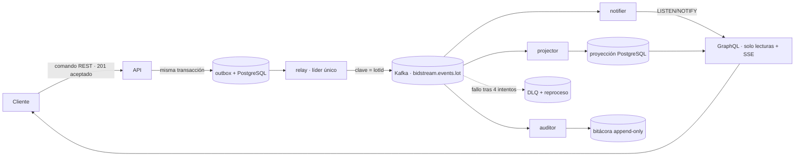

# bidstream

[](https://github.com/franz-yapu/bidstream/actions/workflows/ci.yml)

## Qué es

Motor de subastas en tiempo real orientado a eventos: cada puja, apertura y cierre es un evento
inmutable en **Kafka**, y todo lo demás (lo que se ve, lo que se notifica, lo que se audita) se deriva
de ese log. Sirve para cualquier producto con cierres competitivos y varios espectadores a la vez:
subastas de arte o de café, compra de capacidad, licitaciones, ofertas relámpago.

Es la segunda versión de un dominio que ya construí con WebSockets y bloqueos en base de datos
([`subastas-cafe-api`](#qué-cambió-respecto-a-la-versión-con-websockets-y-bloqueos-en-base-de-datos)):
aquí el interés está en **cómo** se resuelve, no en el catálogo de funciones.

## Cómo funciona



1. **La API acepta comandos**, los valida y escribe el evento en la tabla `outbox` **en la misma
   transacción**. Nunca habla con Kafka: así no hay escritura dual ([ADR-0002](docs/adr/0002-patron-outbox.md)).
2. **Un relay** publica el outbox en Kafka, en orden, con `lotId` como clave de partición
   ([ADR-0001](docs/adr/0001-clave-de-particion-lotid.md), [ADR-0006](docs/adr/0006-un-unico-relay-activo.md)).
3. **Tres consumidores independientes** leen el mismo topic: `projector` (la vista consultable),
   `notifier` (tiempo real) y `auditor` (bitácora inmutable). Una cola no permite que tres lectores
   vean el mismo mensaje; un log, sí.
4. **GraphQL solo lee** de la proyección y empuja cambios por SSE ([ADR-0004](docs/adr/0004-graphql-solo-lecturas.md),
   [ADR-0008](docs/adr/0008-tiempo-real-listen-notify-sse.md)).
5. **Cada consumidor es idempotente** y los fallos van a un DLQ reprocesable
   ([ADR-0007](docs/adr/0007-consumidores-idempotentes-y-dlq.md)).

## Qué cambió respecto a la versión con WebSockets y bloqueos en base de datos

La versión anterior ([`subastas-cafe-api`](https://github.com/franz-yapu/subastas-cafe-api): NestJS, Prisma,
Socket.io) serializa las pujas de un lote con `pg_advisory_xact_lock(hashtext(loteId))` dentro de una
transacción y avisa a los compradores por un gateway WebSocket. Funciona y es correcta. Estas son las
diferencias, sin cifras que no he medido:

| Aspecto                                | Versión anterior                                          | bidstream                                                                                   |
| -------------------------------------- | --------------------------------------------------------- | ------------------------------------------------------------------------------------------- |
| Orden de las pujas de un lote          | Bloqueo asesor en PostgreSQL                              | Partición por `lotId` ([ADR-0001](docs/adr/0001-clave-de-particion-lotid.md))               |
| Dónde escala                           | Verticalmente, en la base: todas las pujas pasan por ella | Horizontalmente: particiones y consumidores                                                 |
| Qué se guarda                          | El estado actual (filas de pujas)                         | El historial inmutable de eventos                                                           |
| Corregir o cambiar la vista de lectura | Migrar datos                                              | Reconstruirla desde el log ([ADR-0009](docs/adr/0009-el-log-es-la-fuente-de-verdad.md))     |
| Tiempo real                            | Gateway WebSocket con estado en cada instancia            | `LISTEN/NOTIFY` + SSE ([ADR-0008](docs/adr/0008-tiempo-real-listen-notify-sse.md))          |
| Respuesta a una puja                   | El resultado, de inmediato                                | «Aceptada» y el resultado llega después ([ADR-0003](docs/adr/0003-la-puja-devuelve-202.md)) |
| Piezas que operar                      | Una base y un proceso                                     | Kafka, outbox, relay, tres consumidores y GraphQL                                           |
| Consistencia de lo que se lee          | Fuerte                                                    | Eventual                                                                                    |

### Qué ganas

- **Orden sin bloqueos.** El orden por lote lo impone la partición, no una cerradura en la base.
- **Auditoría y reproceso reales.** El log es la verdad: puedes reconstruir la proyección y comprobar que
  queda idéntica (ver [Reproceso](#reproceso-el-log-es-la-fuente-de-verdad)).
- **Lectores independientes.** Añadir una notificación, un informe o un modelo nuevo es añadir un
  consumidor, sin tocar el camino de escritura.
- **Tolerancia a fallos.** Si un consumidor cae, el log espera; si un evento falla, va al DLQ y no
  detiene al resto.

### Qué pierdes

- **Simplicidad.** Pasas de una base y un proceso a varios componentes que operar, monitorizar y desplegar.
- **Consistencia inmediata.** Lo que se lee puede ir por detrás de lo que se escribió; el cliente tiene
  que esperar el resultado de una puja.
- **Entrega exacta.** Es _al menos una vez_: todo consumidor debe ser idempotente.
- **Funciones de producto.** Esta versión es el motor: no tiene (todavía) usuarios, roles, correo,
  i18n ni marca blanca, que la anterior sí tiene.

### Cuándo elegiría cada una

- **La anterior**, si el volumen es modesto, el equipo es pequeño y la consistencia inmediata y la
  simplicidad operativa pesan más que la auditoría o la escala.
- **bidstream**, si hay mucha concurrencia por lote, hace falta un historial inmutable y poder
  rehacer las vistas, o varios sistemas necesitan reaccionar a las mismas pujas.

## Decisiones de diseño

Cada decisión tiene su ADR, con las alternativas descartadas y las pruebas que la respaldan
([índice](docs/adr/README.md)).

| ADR                                                        | Decisión                                                           |
| ---------------------------------------------------------- | ------------------------------------------------------------------ |
| [0001](docs/adr/0001-clave-de-particion-lotid.md)          | Clave de partición `lotId`: el orden por lote lo da Kafka          |
| [0002](docs/adr/0002-patron-outbox.md)                     | Outbox: nunca escritura dual                                       |
| [0003](docs/adr/0003-la-puja-devuelve-202.md)              | La puja devuelve `202 Accepted` _(decidido; se implementa con C3)_ |
| [0004](docs/adr/0004-graphql-solo-lecturas.md)             | GraphQL solo para lecturas, REST para comandos                     |
| [0005](docs/adr/0005-proyeccion-sin-fk-entre-agregados.md) | Proyección sin clave foránea entre agregados                       |
| [0006](docs/adr/0006-un-unico-relay-activo.md)             | Un único relay activo con bloqueo asesor                           |
| [0007](docs/adr/0007-consumidores-idempotentes-y-dlq.md)   | Consumidores idempotentes, reintentos y DLQ                        |
| [0008](docs/adr/0008-tiempo-real-listen-notify-sse.md)     | Tiempo real con `LISTEN/NOTIFY` y SSE                              |
| [0009](docs/adr/0009-el-log-es-la-fuente-de-verdad.md)     | El log es la fuente de verdad: reproceso desde `earliest`          |
| [0010](docs/adr/0010-tenant-provisional-por-cabecera.md)   | Tenant provisional por cabecera, prohibido en producción           |

Otros detalles que conviene mirar:

- **Dinero siempre en `Decimal(12,2)`** (y como cadena `Money` en GraphQL), nunca en flotantes.
- **Un índice único parcial** (`bid_one_awarded_per_lot_idx`) impide dos pujas adjudicadas en el mismo lote.
- **Límites en GraphQL**: profundidad, complejidad, alias, tokens y paginación por cursor; sin ellos una
  API GraphQL es una denegación de servicio esperando a ocurrir.
- **Logs con id de correlación** que viaja de la petición HTTP a los consumidores, con redacción de secretos.
- **El método**: cada ticket tiene su SDD aprobado antes del código ([`docs/sdd/`](docs/sdd/)) y cada
  decisión queda en [`docs/decisions/LOG.md`](docs/decisions/LOG.md).

## Reproceso: el log es la fuente de verdad

Lo que una cola no puede hacer: **borrar la proyección entera, volver al principio del log y
reconstruirla sola**, con el mismo estado. La demostración lo comprueba con una huella SHA-256 del
estado antes y después:

```bash
make up && make demo-reprocess
```

<!-- VIDEO-PENDIENTE -->

**Vídeo:** pendiente de grabar (guion en [`docs/demo/GUION.md`](docs/demo/GUION.md)).

## Stack y puesta en marcha

TypeScript (Node 22) · Fastify + Zod · Apache Kafka (KRaft) · PostgreSQL 16 + Prisma 7 · GraphQL (Yoga) ·
Vitest · Docker · GitHub Actions. El despliegue previsto es Azure (Event Hubs con el mismo cliente Kafka,
Container Apps, Bicep).

Requisitos: Docker y Node 22 (`nvm use`).

```bash
npm ci && make demo
```

Levanta Kafka y PostgreSQL, aplica las migraciones y arranca los seis procesos en contenedores. Después:

```bash
scripts/demo-smoke.sh   # una subasta entra por REST y aparece por GraphQL
make demo-down          # detener
```

- API REST (comandos): <http://localhost:3000/v1/docs>
- GraphQL (lecturas): <http://localhost:4000/graphql>

Para desarrollar, probar o depurar proceso a proceso: [`docs/DESARROLLO.md`](docs/DESARROLLO.md).

## Estado y límites

Lo que está hecho y probado (más de 360 pruebas unitarias y 230 de integración contra Kafka y
PostgreSQL reales):

- Comandos REST de subastas y lotes, outbox, relay, los tres consumidores, proyección, GraphQL con
  límites y subscriptions, DLQ con reproceso administrativo, reproceso completo desde el log, logs con
  correlación, imágenes de contenedor y CI con auditoría de dependencias.

Lo que **no** está todavía:

- **La puja (`POST …/bids`)** y la regla de quién decide el precio ganador: pendiente de una decisión de
  diseño sobre la autoridad de la puja.
- **Autenticación y usuarios.** Mientras tanto el tenant llega por cabecera y la API **no arranca con
  `NODE_ENV=production`** ([ADR-0010](docs/adr/0010-tenant-provisional-por-cabecera.md)).
- **Firma de eventos, cierre automático de lotes y `SECURITY.md`** con el mapeo OWASP.
- **Despliegue en Azure** (Bicep, Event Hubs, Container Apps) y métricas de _consumer lag_.

Documentación: [especificación](docs/product/bidstream_spec.md) · [ADR](docs/adr/README.md) ·
[SDD por ticket](docs/sdd/) · [guía de desarrollo](docs/DESARROLLO.md).
