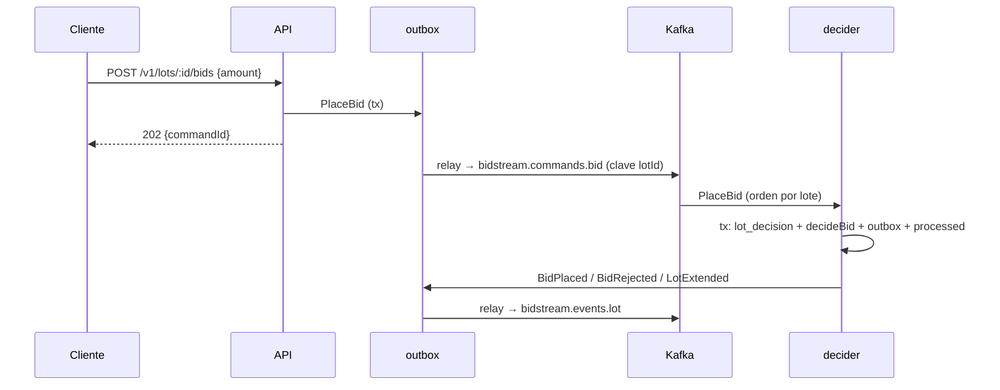

# SDD — C3 · `POST /v1/lots/:id/bids`: 202 Accepted y consumidor decisor

- **Ticket:** ClickUp **C3** (`868mw2q2m`, https://app.clickup.com/t/868mw2q2m).
- **Autor:** generado con Claude (Entregable 1).
- **Estado:** Aprobado (2026-11-13)
- **Versión:** 0.1 · **Fecha:** 2026-11-13
- **Decisión que lo desbloquea:** **Q2** = consumidor decisor por Kafka (respuesta del usuario, 2026-11-13).
- **Fuentes de verdad citadas:**
  1. `docs/product/bidstream_spec.md` §4 (`bidstream.commands.bid`, clave `lotId`, 6 particiones), §5 (arquitectura), §7 (202, `Idempotency-Key`)
  2. `packages/domain/src/lot/decide-bid.ts` (`decideBid`: ya devuelve `BidRejected`, `BidPlaced` o `BidPlaced + LotExtended`), `state.ts` (`evolveLot`, `foldLot`), `decide-close.ts`
  3. `docs/adr/0001`, `0003`, `0006`, `0007` y `docs/sdd/D1`, `D3` (relay, procesador con idempotencia/DLQ)
  4. `packages/db/src/repositories/outbox.ts` (el outbox solo escribe `DomainEvent`), `packages/consumer/src/processor.ts` (solo entiende eventos)

---

## 0 · Preguntas que el ticket pidió cerrar

| # | Pregunta | Respuesta |
|---|---|---|
| 1 | ¿Quién decide la puja? | Un **consumidor decisor** (`apps/decider`) sobre `bidstream.commands.bid`: el orden por lote lo da la partición, no un bloqueo (Q2) |
| 2 | ¿Qué hace la API? | Acepta (202), valida la forma y que el lote existe, y publica un **comando** por el outbox; no decide |

---

## 1 · Alcance

### Entra

- **Comando `PlaceBid`** (contrato en `packages/domain/src/commands/`): `{ commandId, type: 'PlaceBid', version: 1, tenantId, receivedAt, payload: { lotId, bidderId, amount }, meta?: { correlationId } }`, con su esquema Zod y pruebas.
- **API** `POST /v1/lots/:id/bids` (cuerpo `{ amount }`): `202 { commandId, status: 'ACCEPTED' }` con `Location` a la consulta; `404` + `Retry-After` si el lote aún no está en la proyección; `400/422` por forma. Los rechazos de negocio **no** son errores HTTP: son el evento `BidRejected`.
- **Outbox de comandos**: `PrismaOutbox.enqueueCommand(command, topic)` (misma tabla, `id = commandId`, clave `lotId`). El relay ya publica cualquier fila.
- **`apps/decider`** (nuevo proceso, imagen `decider`): consume `bidstream.commands.bid` (grupo `decider`) con el procesador de D3 generalizado (`parse` configurable) y, en **una transacción**: lee el estado del lote, ejecuta `decideBid`, actualiza el estado y encola los eventos (`BidPlaced`/`BidRejected`/`LotExtended`) en el outbox hacia `bidstream.events.lot`.
- **Modelo de escritura `lot_decision`** (tabla nueva): `lot_id` PK, `tenant_id` y las columnas de `LotState`. Es el estado **autoritativo** para decidir (la proyección va por detrás y no sirve, §2.2).
- **Alimentación de `lot_decision`**: el decisor consume también `bidstream.events.lot` (grupo `decider-state`) para `LotPublished` (crea el estado), `LotClosed` y `LotExtended`; sus propios eventos se aplican **en la misma transacción** de la decisión (write-through) y se registran como ya procesados para que ese consumidor no los aplique dos veces.
- **Anti-sniping**: `AntiSnipingConfig` por entorno (`ANTI_SNIPING_WINDOW_MS`, `ANTI_SNIPING_EXTENSION_MS`), sin valores por defecto en el dominio (§7.1).
- Imagen Docker, servicio en el compose (`make demo`), job de humo en la CI y ADR actualizado.

### No entra (a propósito)

- `Idempotency-Key` → **C4** (este ticket deja el hueco: `commandId` lo genera el servidor).
- Identidad real del postor → **F1** (hasta entonces `X-Bidder-Id`, solo fuera de producción, como el tenant en ADR-0010).
- Límite de pujas por minuto → F2. Cierre por tiempo → D8.

### Premisas verificadas (heredadas de `task-brief`)

| Premisa del ticket | Qué hay de verdad |
|---|---|
| «Valida contra la proyección y escribe en el outbox» (spec §5) | La proyección es **eventualmente consistente**: dos pujas seguidas al mismo lote se decidirían contra el mismo precio viejo. Por eso la autoridad es el decisor con su propio estado (Q2) |
| `decideBid` ya existe | Sí, puro y probado; devuelve `EventDraft[]`. Falta ponerlo en un proceso |
| El outbox sirve para comandos | Hoy solo acepta `DomainEvent` (`partitionKey(event)`); hay que añadir `enqueueCommand` |
| `bidstream.commands.bid` existe | Sí, creado por `make up` (6 particiones, 7 días); **nadie lo usa** |
| El procesador (D3) sirve para comandos | Está acoplado a `parseEvent`; se generaliza con un `parse` inyectable |
| `bidderId` | No existe identidad hasta F1 |

---

## 2 · Diseño técnico

### 2.1 Flujo

### 2.2 Por qué un estado propio y no la proyección

El decisor lee `lot_decision` dentro de su transacción; las decisiones de un lote llegan **en orden** por la partición y se escriben antes de la siguiente, así que cada puja ve el resultado de la anterior sin depender del `projector`. La proyección queda como vista de lectura.

### 2.3 Casos límite

| Caso | Tratamiento |
|---|---|
| Comando para un lote sin `lot_decision` (el decisor va por detrás en `LotPublished`) | Error **reintentable** (`LotStateNotReady`): el procesador reintenta con backoff; agotado, al DLQ (reprocesable por D7). No es un rechazo |
| Comando duplicado (reentrega) | `processed_event(commandId, 'decider')`: se ignora |
| Puja posterior a un cierre que aún no llegó al estado | Imposible por diseño: el cierre entra por la misma partición como comando `CloseLot` (D8) |
| Reproceso | `lot_decision` es derivable: se reconstruye desde el log de eventos (mismo `evolveLot`) |
| Reloj | `placedAt = receivedAt` del comando (hora de la API), no la del decisor: el resultado no depende de cuándo se procese |

### 2.4 Decisiones y por qué

| Decisión | Elección | Por qué |
|---|---|---|
| Fuente del estado | Tabla propia `lot_decision`, escritura directa | La proyección es eventual |
| Escritura de los eventos propios | Write-through en la misma transacción + marca de procesado | Consistencia inmediata entre pujas sin esperar al log |
| Serialización | Orden de partición; además `SELECT … FOR UPDATE` sobre la fila del lote | Defensa en profundidad si hubiese dos decisores durante un rebalanceo |
| Respuesta | `202` con `commandId` | ADR-0003 |
| Comando en el outbox | Misma tabla, `enqueueCommand` | Un solo relay y un solo orden (ADR-0006) |

---

## 3 · Cambios por archivo/módulo

| Archivo/módulo | Cambio |
|---|---|
| `packages/domain/src/commands/` (nuevo) | `placeBid`, `parseCommand`, `commandPartitionKey` |
| `packages/db/prisma` | Migración 0004: `lot_decision` (+ índice) |
| `packages/db/src/repositories/outbox.ts` | `enqueueCommand` |
| `packages/db/src/decision/` (nuevo) | `PrismaLotDecisionRepository` (`find ForUpdate`, `save`), `applyEventToDecision` |
| `packages/consumer` | Procesador con `parse` inyectable; `LotStateNotReady` reintentable |
| `apps/decider` (nuevo) | `main.ts`, `decider.ts`, dos consumidores (`commands`, `state`) |
| `apps/api` | Ruta `POST /v1/lots/:id/bids` + comando `placeBid`, OpenAPI |
| `Dockerfile`, `docker-compose.yml`, CI | Imagen y servicio `decider`; matriz de la CI |
| `docs/adr/0003-…` | De «sin implementar» a «Aceptada e implementada»; ADR nuevo 0011 (decisor único por lote) |
| `README.md`, `CLAUDE.md` | La puja deja de ser «pendiente» (lo exigen las pruebas de documentación) |

---

## 4 · Plan de tests

| Caso | Nivel | Cubre |
|---|---|---|
| El comando `PlaceBid` valida forma, dinero y UUID; rechaza campos extra | unit | Contrato |
| `POST` válido → `202` + fila de outbox con clave `lotId`; lote desconocido → `404` + `Retry-After`; monto inválido → `400` | integración | API |
| Rollback si falla el outbox: no queda comando | integración | Atomicidad |
| Decisor: puja válida → `BidPlaced`; baja → `BidRejected(BID_TOO_LOW)`; en ventana → `BidPlaced + LotExtended` | integración | Reglas 1–3 |
| **Dos pujas del mismo monto seguidas**: gana la primera, la segunda se rechaza (sin esperar al projector) | integración | Orden por partición |
| **50 pujas concurrentes** a un lote desde la API: el resultado coincide con `foldLot` del historial y hay una sola ganadora | integración | Concurrencia |
| Comando duplicado no duplica eventos | integración | Idempotencia |
| Lote sin estado → reintenta y, agotado, va al DLQ; tras el reproceso (D7) se decide | integración | `LotStateNotReady` |
| `lot_decision` reconstruido desde el log == estado en vivo | integración | Reproceso |
| Flujo completo REST → comando → decisor → evento → proyección → GraphQL | integración | Extremo a extremo |
| `lotBids`/`lot` no exponen `bidderId` | integración | Privacidad |

**Deliberadamente sin test:** rendimiento absoluto (no se hacen afirmaciones sin medir).

---

## 5 · Definition of Done

- [ ] SDD Aprobado; ticket en ClickUp
- [ ] Implementación según el SDD, incluida la imagen del decisor y el humo de la CI
- [ ] Tests del §4 en verde; `npm run check` e `integration` en verde
- [ ] ADR-0003 y el nuevo ADR; README sin «pendiente» para la puja
- [ ] PR con CI verde y fusionado

---

## 6 · Riesgos

| Riesgo | Gravedad | Mitigación |
|---|---|---|
| `lot_decision` diverge del log | Alta | Misma `evolveLot`; prueba de reconstrucción; reproceso del estado |
| Carrera `LotPublished` ↔ primera puja | Media | Error reintentable + DLQ reprocesable |
| Dos decisores durante un rebalanceo | Media | `FOR UPDATE` sobre el lote + idempotencia por `commandId` |
| Doble escritura (estado y outbox) | Alta | Misma transacción de PostgreSQL |
| Más componentes que operar | Baja | Es el precio de Q2, ya aceptado y documentado en el README |

---

## 7 · Preguntas abiertas

1. **Anti-sniping (Q7 del backlog):** valores de la ventana y la extensión. Propuesta: `ANTI_SNIPING_WINDOW_MS=120000` (2 min) y `ANTI_SNIPING_EXTENSION_MS=120000`, por entorno (no por subasta todavía). ¿Los valores?
2. **Identidad provisional del postor:** cabecera `X-Bidder-Id` solo fuera de producción hasta F1 (propuesta). ¿Bien?
3. **Estado propio del decisor** (`lot_decision`, write-through) y no la proyección (propuesta). ¿De acuerdo?
4. **Lote aún no visible para el decisor:** reintentar y, si no, DLQ (propuesta), no rechazar. ¿Bien?
5. **Respuesta `202`** con `commandId` y consulta por GraphQL/subscription (sin endpoint `GET` de comandos). ¿Bien?
