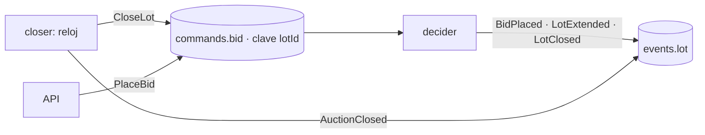

# SDD — D8 · Cierre de lotes y subastas: el `closer`

- **Ticket:** ClickUp **D8** (`868mw2q32`, https://app.clickup.com/t/868mw2q32).
- **Autor:** generado con Claude (Entregable 1).
- **Estado:** Aprobado (2026-11-13)
- **Versión:** 0.1 · **Fecha:** 2026-11-13
- **Decisión que lo desbloquea:** **Q3** = worker `closer` con líder único (respuesta del usuario, 2026-11-13).
- **Fuentes de verdad citadas:** spec §2 y §3 (reglas 4 y 5: al llegar `closesAt` se adjudica); `packages/domain/src/lot/decide-close.ts` (`decideCloseLot`), `auction/state.ts` (`decideCloseAuction`); `apps/relay/src/leader.ts` (bloqueo asesor); `docs/sdd/C3/SDD.md`; `docs/adr/0006`

---

## 0 · Preguntas que el ticket pidió cerrar

| # | Pregunta | Respuesta |
|---|---|---|
| 1 | ¿Quién emite `LotClosed`, `AuctionClosed` y `LotExtended`? | `LotExtended` y `LotClosed`: el **decisor** (C3), que es el único escritor de un lote. `AuctionClosed`: el `closer`. El `closer` solo **da la señal de tiempo** |
| 2 | ¿Por qué no emitir `LotClosed` desde el `closer`? | Una puja aceptada tras el cierre rompería la regla 5. Al entrar el cierre por la misma partición que las pujas, el orden queda fijado (§2.1) |

---

## 1 · Alcance

### Entra

- **Comando `CloseLot`** (`{ commandId, type: 'CloseLot', version: 1, tenantId, receivedAt, payload: { lotId } }`) en `bidstream.commands.bid` (clave `lotId`). El decisor lo trata con `decideCloseLot(state, now = receivedAt)`: si aún no toca (el anti-sniping extendió el cierre) o ya está cerrado, no emite nada.
- **`apps/closer`** (proceso nuevo): líder único por bloqueo asesor (como el relay). Cada `CLOSER_POLL_MS` (5 s):
  1. busca en la proyección lotes `open` con `closes_at <= now` y encola `CloseLot` por el outbox (un comando por lote y tick; idempotente por `commandId` determinista `uuid5(lotId, closesAt)`).
  2. busca subastas `open` sin lotes abiertos y `closes_at <= now` y emite `AuctionClosed` (`decideCloseAuction`) por el outbox.
- **Decisor**: maneja `CloseLot`, emite `LotClosed` (y, si el lote era el último abierto de su subasta, deja que el `closer` cierre la subasta).
- Limpieza horaria de `idempotency_key` caducadas (C4, §7.2 de C4).
- Imagen, servicio en el compose, humo en la CI.

### No entra

- Cierre manual por un administrador (no pedido).
- Notificación por correo al ganador (la spec no lo incluye).

### Premisas verificadas

| Premisa | Qué hay de verdad |
|---|---|
| Hay reglas puras de cierre | Sí: `decideCloseLot`, `decideCloseAuction`, probadas; **nadie las ejecuta** |
| `LotExtended` lo emite `decideBid` | Sí (junto a `BidPlaced`): ya es del decisor |
| El `closer` puede leer la proyección | Sí; su desfase solo causa comandos de más o tarde, nunca un cierre indebido porque decide el decisor |
| `AuctionClosed` va por la partición de `auctionId` (A2) | Sí; su orden respecto a los lotes no importa: solo se emite con 0 lotes abiertos |

---

## 2 · Diseño técnico

### 2.1 Un solo escritor por lote

Pujas y cierre comparten partición: o la puja entra antes del cierre y cuenta, o después y se rechaza con `LOT_CLOSED`. No hay carrera.

### 2.2 Decisiones y por qué

| Decisión | Elección | Por qué |
|---|---|---|
| Qué emite el `closer` | Una señal (`CloseLot`), no el hecho | Evita pujas posteriores al cierre |
| Idempotencia de la señal | `commandId` determinista | Un `closer` que se repite no duplica |
| Liderazgo | Bloqueo asesor (reutiliza `tryAcquireLeadership`) | Mismo mecanismo ya probado |
| Intervalo | 5 s configurable | Precisión suficiente; el anti-sniping manda sobre el reloj |
| Precisión | El cierre se decide con la hora del comando | Resultado determinista al reprocesar |

---

## 3 · Cambios por archivo/módulo

| Archivo/módulo | Cambio |
|---|---|
| `packages/domain/src/commands/` | `closeLot` |
| `apps/decider` | Manejador de `CloseLot` |
| `packages/db` | Consultas de lotes vencidos y subastas sin lotes abiertos; borrado de claves caducadas |
| `apps/closer` (nuevo) | `closer.ts`, `main.ts`, liderazgo |
| Dockerfile, compose, CI | Imagen y servicio `closer` |
| README, CLAUDE.md | Cierre automático deja de ser «pendiente» |

---

## 4 · Plan de tests

| Caso | Nivel | Cubre |
|---|---|---|
| `CloseLot` antes de `closesAt` o sobre lote cerrado → no emite | unit | Reglas 4–5 |
| Lote vencido → `LotClosed` con ganador y monto; sin pujas → `winnerId = null` | integración | Adjudicación |
| **Puja a las `closesAt - 1 s` y cierre simultáneo**: o cuenta o se rechaza, nunca ambas ni un ganador distinto del último `BidPlaced` | integración | Sin carrera |
| Anti-sniping: una puja en ventana extiende; el `CloseLot` temprano no cierra | integración | Extensión |
| Dos `closer` a la vez: solo uno emite | integración | Líder único |
| El `closer` repetido no duplica `LotClosed` | integración | Idempotencia |
| Último lote cerrado → `AuctionClosed` una sola vez | integración | Subasta |
| Flujo completo hasta GraphQL: lote `closed` con `winner` y subscription con el cierre | integración | Extremo a extremo |
| Reproceso desde el log reproduce los mismos cierres | integración | Determinismo |

---

## 5 · Definition of Done

- [ ] SDD Aprobado; implementación; tests del §4; `npm run check` e `integration` en verde; PR fusionado

## 6 · Riesgos

| Riesgo | Gravedad | Mitigación |
|---|---|---|
| Reloj del `closer` adelantado/atrasado | Media | Decide el decisor con `receivedAt`; solo se adelanta o retrasa la señal |
| `closer` caído | Media | Los lotes se cierran al volver (comandos idempotentes); alerta en H4 |
| Muchas señales por tick | Baja | Un comando por lote vencido y límite por tick |

## 7 · Preguntas abiertas

1. **Intervalo del `closer`:** 5 s (propuesta). ¿Bien?
2. **`AuctionClosed` desde el `closer`** y `LotClosed` desde el decisor (propuesta). ¿De acuerdo?
3. **Limpieza de claves de idempotencia dentro del `closer`** (propuesta).
