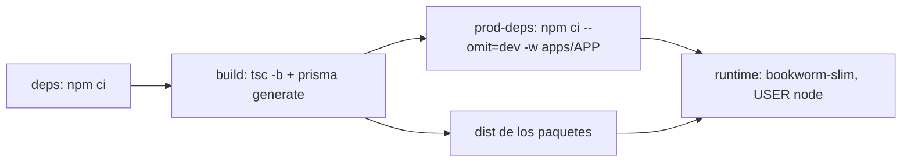

# SDD — H2 · Dockerfiles de API, relay y consumidores

- **Ticket:** ClickUp **H2** (`868mvty1v`, https://app.clickup.com/t/868mvty1v).
- **Autor:** generado con Claude (Entregable 1).
- **Estado:** Implementado (2026-11-13)
- **Versión:** 0.1 · **Fecha:** 2026-11-13
- **Fuentes de verdad citadas:**
  1. `docs/product/bidstream_spec.md` §9 (Azure Container Apps: API, relay y tres consumidores, cada uno con su escalado; Azure Container Registry)
  2. `package.json` raíz y `apps/*/package.json` (workspaces, `main: dist/…`, `start: node dist/main.js`), `packages/db` (Prisma 7, cliente generado en `postinstall`)
  3. `.github/workflows/ci.yml`, `security.yml` (acciones por SHA) y `packages/testing/src/policy/repo-policy.test.ts`
  4. Docker 27.2.0 disponible en la máquina de desarrollo (se puede construir y probar de verdad)

---

## 0 · Preguntas que el ticket pidió cerrar

| # | Pregunta del ticket | Respuesta |
|---|---|---|
| 1 | ¿Qué procesos tienen imagen? | Los seis de `apps/`: `api`, `relay`, `projector`, `auditor`, `notifier`, `graphql` |
| 2 | ¿Cómo se evitan secretos en imágenes? | Nada de `ENV`/`ARG` con valores; `.dockerignore` excluye `.env*`; prueba que lo comprueba |

---

## 1 · Alcance

### Entra

- **Un solo `Dockerfile`** en la raíz, multi-etapa y parametrizado por `ARG APP` (uno de los seis), porque los seis comparten el monorepo y los mismos paquetes.
- Etapas: `deps` (instala con `npm ci`) → `build` (`tsc -b`, `prisma generate`) → `runtime` (solo dependencias de producción de ese workspace + `dist/`).
- Imagen final: `node:22-bookworm-slim` (el cliente `@confluentinc/kafka-javascript` trae binarios para glibc: **no Alpine**), **usuario no root** (`node`), `NODE_ENV=production`, `CMD ["node", "apps/<app>/dist/main.js"]`, sin `npm`/compiladores en la etapa final.
- `.dockerignore` (excluye `.git`, `node_modules`, `dist`, `.env*`, `docs/`, `*.md` salvo los necesarios…).
- Job **`docker`** en CI: construye las seis imágenes (sin publicar) y arranca una de cada tipo para comprobar que el proceso llega a su mensaje de inicio.
- `HEALTHCHECK` en las imágenes que escuchan (`api`, `graphql`).
- Base **fijada por digest** y vigilada por Dependabot (ecosistema `docker`).

### No entra (a propósito)

- Publicar en Azure Container Registry y el despliegue (H1/H3).
- Orquestación local con compose de los procesos de la aplicación (se mantiene `make up` solo para Kafka y PostgreSQL).
- Escaneo de vulnerabilidades de imagen (ver pregunta 4).

### Premisas verificadas (heredadas de `task-brief`)

| Premisa del ticket | Qué hay de verdad |
|---|---|
| «Dockerfiles de API, relay y consumidores» | Hay **seis** procesos (`graphql` y `notifier` también), cada uno con `dist/main.js` y script `start` |
| «Imagen mínima» | `@confluentinc/kafka-javascript` es nativo y exige glibc; `@prisma/client` necesita su cliente generado: la imagen mínima viable es `bookworm-slim`, no `alpine` ni `distroless/static` |
| «Sin secretos en las imágenes» | La configuración sale de variables de entorno (`DATABASE_URL`, `KAFKA_*`, `ADMIN_API_KEY`): ya hoy no se lee ningún archivo; hay que evitar que `.env` entre en el contexto |
| «Construcción en CI» | La CI actual tiene `check`, `integration` y `audit`; no hay job de imágenes |

---

## 2 · Diseño técnico

### 2.1 Etapas

### 2.2 Decisiones y por qué

| Decisión | Elección | Por qué |
|---|---|---|
| Un Dockerfile o seis | Uno con `ARG APP` | Cambia solo la ruta de arranque; mantener seis copias reproduciría el problema de F4 |
| Base | `node:22-bookworm-slim` por digest | glibc para el cliente Kafka; Node 22 es el requisito del repo |
| Usuario | `node` (uid 1000), sistema de archivos de solo lectura posible | OWASP A05 |
| Dependencias de producción | `npm ci --omit=dev --workspace apps/APP --include-workspace-root` tras compilar | Imagen sin TypeScript, Vitest ni ESLint |
| Scripts de instalación | `--ignore-scripts` y `prisma generate` explícito | Misma política que la CI de seguridad (F6) |
| Secretos | Solo en ejecución, por entorno | Una imagen con un secreto dentro es un secreto filtrado |

---

## 3 · Cambios por archivo/módulo

| Archivo/módulo | Cambio |
|---|---|
| `Dockerfile` (nuevo) | Multi-etapa con `ARG APP` |
| `.dockerignore` (nuevo) | Exclusiones |
| `.github/workflows/ci.yml` | Job `docker` (matriz de 6): `docker build --build-arg APP=…` y humo |
| `.github/dependabot.yml` | Ecosistema `docker` |
| `packages/testing/src/policy/docker-policy.test.ts` (nuevo) | Pruebas de política del Dockerfile (§4) |
| `Makefile` | `make images` (construye las seis) |
| `README.md`, `CLAUDE.md` | Cómo construir y ejecutar una imagen |

---

## 4 · Plan de tests

| Caso | Nivel | Cubre |
|---|---|---|
| El Dockerfile tiene ≥ 2 etapas y la última termina con `USER` distinto de root | política | No root |
| Toda imagen base está fijada por digest (`@sha256:`) | política | Reproducibilidad |
| Ningún `ENV`/`ARG` contiene `PASSWORD`, `SECRET`, `TOKEN`, `KEY` con valor | política | Sin secretos |
| `.dockerignore` excluye `.env`, `.git`, `node_modules` | política | Contexto limpio |
| La etapa final no copia `.env*` ni instala `devDependencies` | política | Imagen mínima |
| `docker build` de las seis imágenes termina bien | CI | Construcción |
| La imagen `relay`/`projector`/`auditor`/`notifier` arranca y falla con un mensaje claro si falta `DATABASE_URL` | CI (humo) | Configuración |
| La imagen `api` con PostgreSQL y Kafka del job responde `GET /health` | CI (humo) | Arranque real |
| `docker run --user` es no root y `id -u` ≠ 0 | CI (humo) | No root |
| La imagen no contiene `.env` ni `src/` (`docker run … ls`) | CI (humo) | Sin secretos |

**Deliberadamente sin test:** el tamaño exacto de la imagen (se informa, no se exige).

---

## 5 · Definition of Done

- [ ] SDD en `docs/sdd/H2/SDD.md`, Estado = Aprobado
- [ ] Dockerfile y `.dockerignore`; las seis imágenes se construyen **localmente y en CI**
- [ ] Tests del §4 en verde; `npm run check` e `integration` en verde
- [ ] PR con CI verde y fusionado

---

## 6 · Riesgos

| Riesgo | Gravedad | Mitigación |
|---|---|---|
| El binario nativo de Kafka o el cliente Prisma no funcionan en la imagen final | Alta | Se prueba el arranque real de cada imagen en CI, no solo la construcción |
| El workspace completo infla el contexto de construcción | Baja | `.dockerignore` y caché de capas |
| El digest de la base queda viejo | Media | Dependabot `docker` semanal |
| `npm ci --omit=dev` sobre un workspace arrastra paquetes de otros | Baja | Se mide el tamaño y se comprueba que `typescript`/`vitest` no están |

---

## 7 · Preguntas abiertas

1. **Un `Dockerfile` con `ARG APP`** para los seis procesos (propuesta). ¿O seis Dockerfiles?
2. **Base `node:22-bookworm-slim`** fijada por digest (por el binario nativo de Kafka). ¿De acuerdo en descartar Alpine y distroless?
3. **Job `docker` en la CI** que construye y prueba el arranque de las seis imágenes (suma ≈ 4–6 min). ¿Lo exigimos como check requerido más adelante, junto a `integration` y `security`?
4. **Escaneo de vulnerabilidades de la imagen** (Trivy): propuesta de dejarlo informativo y fuera de este ticket (cabe en H1). ¿Bien?
5. **Alcance:** los seis procesos, no solo los cuatro que nombra el ticket (API, relay y consumidores), porque `graphql` y `notifier` también deben desplegarse.

---

## Changelog de implementación

- `Dockerfile` (3 etapas: `build`, `prod-deps`, `runtime`) con `ARG APP`, `.dockerignore`, `make images`, `scripts/docker-smoke.sh`, job `docker` (matriz de 6) y Dependabot `docker`. Imágenes de 418–441 MB (la base slim pesa ≈ 230 MB).
- Desviación: `@prisma/client` arrastra la CLI de Prisma, su estudio y TypeScript; se eliminan de `node_modules` en la etapa de dependencias (580 → 435 MB). Lo cubre el humo, que arranca los seis procesos.
- El humo exige CI o `SMOKE_DISPOSABLE=1`: sin esa guarda, un arranque local consumía y confirmaba offsets de los grupos reales del entorno de desarrollo (ocurrió una vez durante la implementación; solo reprocesó eventos ya existentes, de forma idempotente).
- Pruebas: 15 de política en `docker-policy.test.ts` y el humo de los 6 procesos (no root, sin `.env` ni `src/`, error claro sin `DATABASE_URL`, arranque real, sin cadena de conexión en logs).
- El escaneo de vulnerabilidades de la imagen queda fuera (H1), como se acordó.
